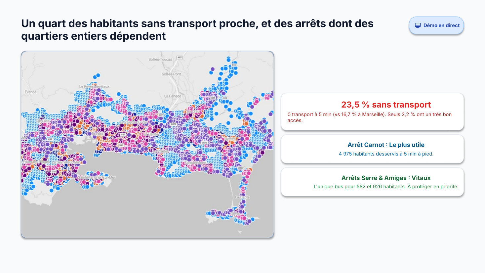
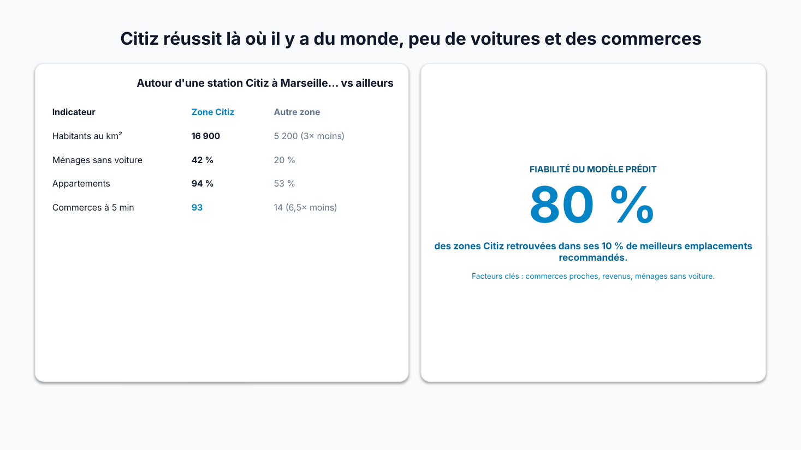
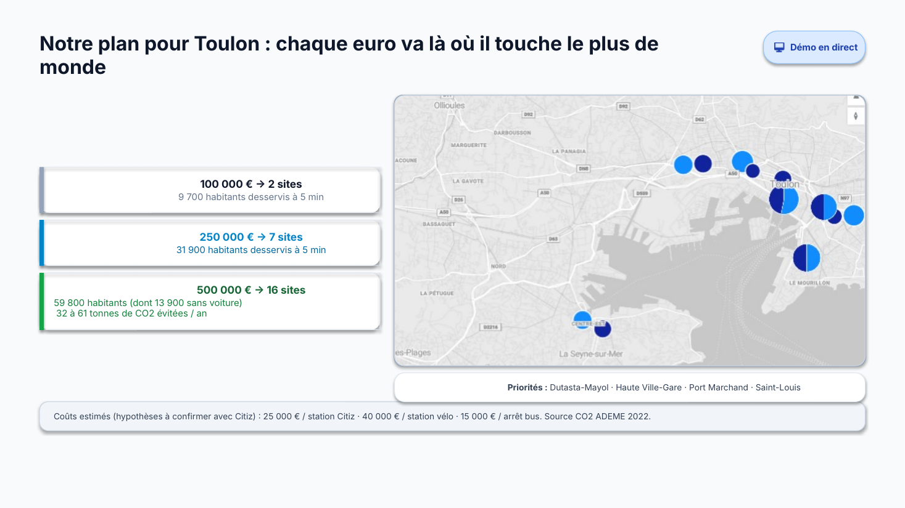

# Où installer Citiz à Toulon ? De l'open data à une décision d'implantation

**Hackathon Mobilité Epitech × Citiz × Microsoft** · octobre 2026 · 2,5 jours · équipe de 5

Outil d'aide à la décision pour choisir où ouvrir de nouvelles stations d'autopartage Citiz à Toulon, selon un budget donné. Construit de bout en bout sur **Microsoft Fabric**, avec uniquement des **données publiques**.


---

## En bref

| | |
|---|---|
| **Problème** | À Toulon, 1 habitant sur 4 n'a aucun transport à 5 minutes à pied, et il n'existe aucune voiture partagée. Où Citiz doit-il s'installer en premier ? |
| **Méthode** | Mesurer l'accès à la mobilité par les vraies rues, apprendre sur Marseille (97 stations Citiz) ce qui fait une bonne station, puis appliquer ce modèle à Toulon. |
| **Résultat** | Modèle Gradient Boosting avec une **AUC de 0,965** (contre 0,872 avec la densité seule). Plan d'investissement chiffré : **500 000 € → 16 sites, 59 800 habitants desservis**. |
| **Recommandation** | Ouvrir la première station Citiz à **Dutasta-Mayol**. |

---

## Résultats clés

**1. Un quart des Toulonnais sans transport proche.** 23,5 % des habitants n'ont aucune option de mobilité à 5 minutes à pied (contre 16,7 % à Marseille). Certains arrêts sont la seule option pour des quartiers entiers.



**2. Ce qui fait une bonne station Citiz.** Sur Marseille, les zones Citiz ont 3 fois plus d'habitants au km², 2 fois plus de ménages sans voiture et 6,5 fois plus de commerces à proximité. Le modèle retrouve **80 % des zones Citiz** dans ses 10 % de meilleurs emplacements.



**3. Un plan chiffré selon le budget.** Chaque site est choisi pour toucher le plus d'habitants par euro investi.

| Budget | Sites | Habitants desservis à 5 min |
|---|---|---|
| 100 000 € | 2 | 9 700 |
| 250 000 € | 7 | 31 900 |
| 500 000 € | 16 | 59 800 (dont 13 900 sans voiture) |



---

## Architecture

Pipeline sur **Microsoft Fabric** selon la méthode médaillon :

```
Open data (INSEE, GTFS, GBFS, OpenStreetMap, IGN)
        │
        ▼
 BRONZE   données brutes             6 notebooks de collecte (dont un pipeline toutes les 30 min)
        │
        ▼
 SILVER   données nettoyées          arrêts, carreaux de 200 m, accès à 5 min à pied, indicateurs
        │
        ▼
 GOLD     tables de décision         carte d'accès, arrêts essentiels, scores et sites recommandés
        │
        ▼
 Power BI + modèle suivi dans MLflow
```

**Étapes principales**

1. **Collecte** de 6 sources open data : population par carreau de 200 m, motorisation des ménages, horaires de bus et trains, stations Citiz et vélos, réseau piéton et commerces OpenStreetMap.
2. **Accès réel à pied** : les 5 minutes (400 m) sont calculées par les rues du réseau piéton, pas à vol d'oiseau.
3. **Indicateur d'accès (méthode 2SFCA)** : il tient compte du nombre d'habitants qui partagent la même option.
4. **Modèle** : 3 modèles comparés avec une validation par blocs de 1 km, pour éviter que des carreaux voisins faussent le test. Le Gradient Boosting est retenu.
5. **Optimisation sous budget** : stations Citiz, arrêts de bus et stations vélo, classés par habitants gagnés pour 1 000 €.

---

## Contenu du dépôt

```
notebooks/
  1_bronze/   collecte des données brutes
  2_silver/   nettoyage, accès à 5 min, indicateurs
  3_gold/     carte d'accès, modèle et optimisation
pipelines/    export du pipeline Fabric de collecte Citiz
powerbi/      rapport Power BI
slides/       présentation de la soutenance
docs/
  guide_technique.md   détail des notebooks et comment relancer le projet
  criteres.md          les 8 critères d'implantation testés sur les données
  sources.md           toutes les sources de données
```

Pour relancer le projet dans Fabric, voir le [guide technique](docs/guide_technique.md).

---

## Limites assumées

- Le modèle apprend **où Citiz est déjà implanté**, pas où il est le plus rentable (pas de données de réservation).
- Un modèle entraîné sur Marseille est appliqué à Toulon, une ville plus petite au relief différent.
- Les coûts par site sont des **hypothèses** de l'équipe, à remplacer par les chiffres réels de Citiz.

Toutes les limites sont détaillées dans le [guide technique](docs/guide_technique.md).

---

## Équipe

Projet réalisé en équipe de 5 à Epitech Paris : Claude Capito (chef de groupe), Talel Ouertani, James-Junior Pamara, Zakaria Abdelkhaled, Colin Parent.

**Mon rôle (Talel Ouertani)** : [À COMPLÉTER — par exemple : collecte des données INSEE et OpenStreetMap, calcul de l'accès à 5 minutes, rapport Power BI]

Données : INSEE, IGN, transport.data.gouv.fr, Citiz (GBFS public), OpenStreetMap © contributeurs OpenStreetMap (licence ODbL).
